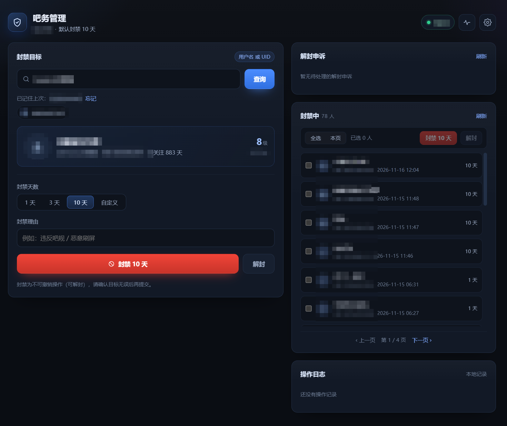

# 吧务管理工具

基于 [aiotieba](https://github.com/lumina37/aiotieba) 的本地吧务工具：输入**用户名或 UID**，
一键封禁该用户在目标贴吧的发言权限，默认 **10 天**。可以打包成**单个 exe**，拷到任意 Windows 电脑上双击运行。

## 功能

- 用户名 / UID / portrait 都能识别，查询后先展示用户卡片（昵称、用户名、UID、吧内等级、吧务身份、关注天数）确认目标
- 封禁天数默认 10 天，支持 1 / 3 / 10 天快捷档位与自定义天数
- 二次确认弹窗，避免封错人
- **记忆**：自动记住最近输入过的用户，下次打开自动填入并回显，输入框下方还有历史目标胶囊可一键切换
- 一键解封、吧务后台「封禁中」列表、本地操作日志
- **批量操作**：「封禁中」列表可勾选（单选 / 全选全部 / 只选本页），一键批量封禁或批量解封，逐条返回结果
- **解封申诉处理**：自动读取吧务后台的待处理申诉，支持单条「通过 / 驳回」与全选批量处理，通过即解封
- 可打包成免安装的单文件 exe，凭证与数据只放在 exe 同目录，不上传任何服务器

## 快速开始

**方式一：直接用 exe（推荐给不装 Python 的电脑）**

双击 `dist/贴吧吧务助手.exe` → 浏览器自动打开页面 → 首次弹出设置面板，
填写 **BDUSS** 和**目标贴吧**即可。程序关闭窗口即退出，配置和日志都留在 exe 同目录。

**方式二：从源码运行**

```bash
pip install -r requirements.txt
python app.py
```

Windows 也可以直接双击 `start.bat`。启动后浏览器会自动打开 <http://127.0.0.1:8765/>。

第一次打开会弹出设置面板，填 BDUSS + 目标贴吧即可。

> 吧名按贴吧里的真实名字填就行，**带不带「吧」都能识别**：程序会同时试「QQ飞车」和「QQ飞车吧」，
> 优先选你在这个吧里有吧务身份的那个（这两个在贴吧里其实是两个不同的吧）。

## 获取 BDUSS

1. 浏览器登录 <https://tieba.baidu.com>
2. 按 `F12` 打开开发者工具 → `Application`（应用）→ `Cookies` → `https://tieba.baidu.com`
3. 找到 `BDUSS`，复制它的**完整 Value**（通常是 192 个字符）

> 也可以把凭证放在环境变量里，避免写进配置文件：`TIEBA_BDUSS` / `TIEBA_STOKEN` / `TIEBA_FNAME`。

## 使用说明

1. 输入用户名或 UID，回车查询；
2. 核对用户卡片，选择封禁天数（默认 10 天）、填写理由；
3. 点「封禁 N 天」→ 弹窗二次确认 → 完成。

关于天数：

| 天数 | 说明 |
| --- | --- |
| 1 / 3 / 10 天 | 贴吧标准封禁档位，**小吧主也能用** |
| 自定义（如 30 天） | 走循环封禁通道，需要**吧主**权限 |

如果你是小吧主，自定义天数会失败并提示权限不足——这是贴吧接口的限制，不是工具的问题。

## 批量封禁 / 解封

右侧「封禁中」列表来自吧务后台，支持多选：

1. 勾选单个用户，或用选择条上的两个快捷按钮：
   - **全选**：一次性选中吧务后台里的全部封禁用户（自动把剩下几页拉完）
   - **本页**：只选中当前这一页的人（会覆盖之前的选择）
   - 两个按钮再点一次都会取消选中；选中的范围会以高亮显示「全选」或「本页」；
2. 选择栏会显示「已选 N 人」，按钮上的天数跟着左侧「封禁天数」变化；翻页后已选的人不会丢；
3. 点「封禁 N 天」→ 弹窗列出这批人 + 时长理由 → 确认后逐个提交；
4. 结束后弹窗给出「成功 X 人 / 失败 Y 人」，失败的人附上各自的原因。

几点说明：

- 这批人本来就在封禁中，重新封禁等于**续封**：到期时间会被重置为「现在 + N 天」；
- 单次请求最多 50 人，超过会自动分批依次提交（弹窗里会提示分成几批），中途别关页面；
- 每一条都是独立请求，某个人失败不会影响其他人；成功/失败都会写进本地日志；
- 列表默认每页 20 人，底部「上一页 / 下一页」翻页。

## 解封申诉处理

右侧「解封申诉」卡片会自动读取吧务后台里**待处理**的申诉（包括申诉理由、原封禁天数、
原封禁理由、封禁时间），不用再切到网页后台一条条点。

每条申诉右侧有两个按钮：

- **通过**：等于**立即解封**，这个人马上恢复发言权限；
- **驳回**：只关闭这条申诉，**不会延长**封禁。如果觉得处罚偏轻，处理完到左侧重新封禁即可。

也可以勾选复选框批量操作，选择条上的「全选」一次选中全部待处理申诉，
再点顶部的「通过」或「驳回」，弹窗会列出这批人和各自的申诉理由供最后核对。

几点说明：

- 处理成功的会从列表里消失，失败的留在原地，可以直接重试；
- 「通过」是不可撤销的方向（如需再封只能重新封禁），所以有二次确认弹窗；
- 单次最多处理 30 条（贴吧接口限制）；
- 每次处理都会写进本地日志，连申诉理由一起记下来，方便回溯；
- 申诉处理需要吧务后台的「**解封申诉**」权限：大吧主默认具备，**小吧主需要吧主额外分配**这一项，
  否则会提示无权限。

## 打包成 exe

已经打好的一份在 `dist/贴吧吧务助手.exe`（约 21 MB，单文件，目标机不需要装 Python）。

要重新打包（改过代码之后）：

```bash
build.bat
# 等价于：
# pip install -r requirements.txt pyinstaller
# pyinstaller --onefile --name "贴吧吧务助手" --icon icon.ico --add-data "web;web" app.py
```

分发时**只拷这一个 exe** 就行。首次运行会在 exe 同目录生成：

```
贴吧吧务助手.exe
config.json     ← 你的 BDUSS 和吧名，只在本机
data/bawu.db    ← 记忆的目标 + 操作日志
```

几点说明：

- **便携**：这俩文件跟着 exe 走，换电脑拷整个文件夹即可；删掉它们等于恢复出厂设置。
  如果放在 `C:\Program Files` 这类不可写目录，会自动改存到 `%APPDATA%\TiebaBawu`。
- **防火墙提示**：程序只监听 `127.0.0.1`，Windows 弹窗可以直接允许「专用网络」，公网访问不到。
- **杀软误报**：PyInstaller 单文件包偶尔会被杀软/Defender 拦，加信任即可；在意的话可以改用 `--onedir` 打包。
- **重复启动**：已在运行时再双击，不会再开一份，而是直接打开已有页面。
- **端口**：默认 8765，被占用时自动顺延到 8766、8767…（最多试 10 个）。

## 目录结构

```
tieba-bawu/
├─ app.py            # HTTP 服务与接口路由（仅标准库）
├─ tieba_service.py  # aiotieba 封装：解析用户 / 封禁 / 解封 / 封禁列表 / 申诉处理
├─ store.py          # SQLite：记忆目标 + 操作日志
├─ config.py         # 配置读写（config.json）
├─ paths.py          # 运行目录 / 资源目录解析（源码运行与打包后一致）
├─ web/              # 前端页面
├─ icon.ico          # 应用图标
├─ build.bat         # 一键打包
├─ dist/             # 打包产物（贴吧吧务助手.exe）
├─ data/bawu.db      # 运行时自动生成
└─ config.json       # 运行时自动生成（含凭证，勿外传）
```

## 常见问题

**提示「3150003 操作失败，无封禁权限」**：八成是吧名指到了另一个空吧。贴吧里「QQ飞车」和「QQ飞车吧」
是**两个不同的吧**，后者只有 9 个帖子、没有吧务团队，在那里封人当然没权限。
工具现在会自动解析并纠正（优先选你有吧务权限的那个 fid），点右上角「诊断」能看到实际命中的 fid 与你的吧务身份。

**提示「BDUSS 已失效」**：登录态过期了，重新从浏览器复制一次 BDUSS。

**提示「封禁失败：请确认你在该吧有吧务管理权限」**：当前账号不是 QQ飞车吧 的吧主/小吧主，
或者目标用户本身是吧务成员（吧务之间不能互相封禁）。

**换一个吧怎么办**：设置里把「目标贴吧」改成别的吧名即可，比如 `天堂鸡汤吧`。

**端口被占用**：不用改配置，程序会自动顺延到 8766、8767…并打印实际地址。想固定端口就改 `config.json` 里的 `port`。

## 说明

封禁是不可逆操作（只能通过解封撤销），工具会记录每一次操作到本地日志。
请在自己有权管理的贴吧内使用，不要用于骚扰他人。
